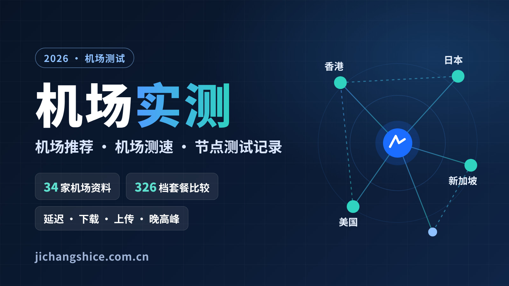

# 机场实测｜2026 机场推荐、机场测速与节点测试记录

**官网：<https://jichangshice.com.cn/>**

机场实测（机场测试）是一个中文机场资料与测速记录网站。我们把各家机场的套餐价格、流量口径和测速结果放在同一套标准下整理，每条数据都写明来源和日期：本站亲自测的、对照结算页核验过的、来自公开资料的，分开标注，不混在一起。

> 本仓库是官网源码。详细数据、完整表格和最新记录都在官网，这里只做介绍和方法摘要。

---

## 关于机场实测

选机场时最常遇到的问题，是不同来源的价格、流量和测速说法对不上。机场实测想做的是把这些资料摊开：

- **写清来源**：每个价格标注“结算页核验”或“历史参考”，每条测速标注“本站实测”或“公开参考”。
- **不编造数据**：没测过的项目写“未测”，不估算、不打分，也不按延迟排名。
- **冲突两边都留**：不同来源记录不一致的套餐两边都保留，不计入最低价。
- **编辑精选不是排名**：精选顺序由编辑安排，参考资料完整度和套餐结构，也考虑合作关系，不代表速度或稳定性高低。

## 测试项目

| 项目 | 记录什么 | 说明 |
| --- | --- | --- |
| 延迟与抖动 | 空载延迟中位数、波动 | 延迟低只说明响应快，不代表带宽大 |
| 下载 / 上传速度 | 多连接平均速度（Mbps） | 受本地宽带、测速服务器位置影响 |
| 满载延迟 | 下载时、上传时的延迟 | 反映看视频、开会时是否卡顿 |
| 晚高峰 | 北京时间 20:00–23:00 与白天对比 | 单晚结果参考价值有限，需连续多天 |
| 丢包 | 连续 20 次以上的比例 | 浏览器测不了，需用客户端或命令行 |
| 出口 IP | 地区、网络 / ASN | 确认测速流量真的经过节点 |
| AI 与流媒体 | 能否打开、登录、完成对话或播放 | 网站能连上 ≠ 账号地区可用，只对当次节点有效 |

## 公开资料

| 内容 | 数量 | 入口 |
| --- | --- | --- |
| 机场资料页 | 34 家 | [机场目录](https://jichangshice.com.cn/airports/) |
| 套餐档位 | 326 档（51 档已对照结算页核验） | [套餐比较](https://jichangshice.com.cn/compare/) |
| 本站实测（已核验） | 5 条：灵动云 4 个节点测速 + 1 次节点在线核验 | [测试档案](https://jichangshice.com.cn/test-records/) |
| 公开测速参考 | 37 批，涉及 21 家机场，逐条附来源链接 | [测试档案](https://jichangshice.com.cn/test-records/) |
| 教程文章 | 30 篇 | [新手教程](https://jichangshice.com.cn/guides/) |
| 常见问题 | 104 问 | [常见问题](https://jichangshice.com.cn/faq/) |

数量核对日期：2026-10-23。网站会持续更新，以官网显示为准。

## 套餐比较

套餐统一按“付款金额 + 付款周期”和“流量 + 重置周期”记录：

- 年付写“¥119/年”，另算折合月均，不会写成“¥119/月”。
- 一次性流量包不折算成月度额度；价格为空不当作 0。
- 每 GB 成本只对“按月重置流量、无来源冲突”的套餐计算。

**编辑精选 5 家 · 月付起步价**

| 机场 | 月付起步 | 价格来源 |
| --- | --- | --- |
| [灵动云](https://jichangshice.com.cn/airports/lingdongyun/) | ¥20/月 · 100GB/月 | 历史参考 |
| [暮光加速](https://jichangshice.com.cn/airports/muguang/) | ¥20/月 · 120GB/月 | 历史参考 |
| [飞猫云](https://jichangshice.com.cn/airports/feimaoyun/) | ¥25/月 · 150GB/月 | 历史参考 |
| [大佬云](https://jichangshice.com.cn/airports/dalaoyun/) | ¥19.99/月 · 100GB/30天 | 结算页核验 |
| [微风网络](https://jichangshice.com.cn/airports/breezenet/) | ¥27/月 · 200GB/月 | 历史参考 |

价格可能随时变化，付款前请以机场官网结算页为准。全部 34 家的最低价套餐表已归档在 [docs/airport-plans-archive.md](docs/airport-plans-archive.md)，最新数据见 [套餐比较](https://jichangshice.com.cn/compare/) 与 [机场推荐](https://jichangshice.com.cn/recommendations/)。

## 测试方法

一次可以复核的测速，至少要写下：测试时间、所在地与运营商、本地带宽、设备与客户端、节点、测速工具和服务器。本站测速的固定流程：

1. 先确认订阅和客户端正常，测速流量确实经过代理（看出口 IP）。
2. 测空载延迟、抖动，再测下载、上传和满载延迟。
3. 逐个节点核对网站连通性、AI 与流媒体访问。
4. 同一节点在晚高峰复测，和白天对照。
5. 保留原始截图，打码出口 IP 和账号后随记录公开。

完整说明见 [测试方法](https://jichangshice.com.cn/testing-methodology/)。也可以连上自己的节点，用官网的 [网速测试](https://jichangshice.com.cn/speedtest/) 工具测出口 IP、延迟、下载上传速度、满载延迟和 15 个常用网站的连通性。测速在浏览器中完成，页面不上传、不保存结果。

## 最近记录

**灵动云 · 2026-10-23 下午（北京时间）**，测试地点广东广州，代理开启状态下用 IPCheck.ing 网速测试：

| 节点 | 测试时间 | 下载 | 上传 | 延迟 | 抖动 |
| --- | --- | ---: | ---: | ---: | ---: |
| 日本 | 14:14 前 | 24.92 Mbps | 21.49 Mbps | 100 ms | 17.95 ms |
| 新加坡 | 14:19 前 | 18.14 Mbps | 13.93 Mbps | 26.33 ms | 9 ms |
| 香港 | 14:22 前 | 24.10 Mbps | 12.96 Mbps | 58.35 ms | 12.07 ms |
| 美国 | 14:30 前 | 18.25 Mbps | 15.52 Mbps | 203.95 ms | 11.98 ms |

这是同一天下午的单次测试，不是晚高峰数据，只说明测试当时的情况。原始截图、出口 IP 归属和网站连通性结果见 [灵动云测试记录](https://jichangshice.com.cn/test-records/lingdongyun/)。

## 教程入口

| 想解决的问题 | 文章 |
| --- | --- |
| 第一次接触机场 | [机场是什么？机场和 VPN 的区别、订阅链接与节点入门](https://jichangshice.com.cn/guides/what-is-airport/) |
| 怎么选套餐 | [根据流量、预算和付款周期选择机场套餐](https://jichangshice.com.cn/guides/how-to-choose-plan/) |
| 导入 Clash 订阅 | [Clash 订阅导入教程：Clash Verge Rev 与 Mihomo](https://jichangshice.com.cn/clients/clash-subscription-import/) |
| 自己测机场 | [2026 年机场测试完整指南：测哪些指标、节点延迟多少算正常](https://jichangshice.com.cn/methods/airport-testing-guide/) |
| 晚高峰怎么测 | [晚高峰稳定性怎么测：测试时段安排与单次测速的局限](https://jichangshice.com.cn/methods/peak-hour-testing/) |
| 连不上怎么办 | [订阅更新失败与节点全部超时的排查路径](https://jichangshice.com.cn/troubleshooting/subscription-update-failed/) |
| AI 访问 | [ChatGPT 能用但 Claude 不可用？节点地区、账号地区与 IP 风险排查](https://jichangshice.com.cn/ai/chatgpt-ok-claude-blocked/) |

更多：[客户端](https://jichangshice.com.cn/clients/) · [线路知识](https://jichangshice.com.cn/routes/) · [故障排查](https://jichangshice.com.cn/troubleshooting/) · [AI 使用](https://jichangshice.com.cn/ai/)

## 常见问题

**机场目录和精选的顺序是排名吗？**
不是。顺序是编辑安排，不代表测速结果或稳定性。比较速度请看测试档案里同一时段、同一环境的记录。

**Clash 里的延迟数字为什么不等于下载速度？**
客户端测的是经由节点访问测试网址的往返时间，只反映连通性和相对快慢；能不能看视频、下载，要用测速工具或实际下载来判断。

**晚高峰测几次才有参考价值？**
建议连续 7 天，每天 20:00–23:00 测 1–2 次，白天测几次作对照，用中位数判断，不看单次最高值。

**月付和年付折算价能直接比吗？**
不能。年付要一次付清，流量有时是全年总量而非每月额度。统一换算成每 GB 成本，并确认流量口径后再比。

更多问题见 [常见问题](https://jichangshice.com.cn/faq/)。

---

## 访问官网

- 官网首页：<https://jichangshice.com.cn/>
- 机场推荐：<https://jichangshice.com.cn/recommendations/>
- 套餐比较：<https://jichangshice.com.cn/compare/>
- 测试档案：<https://jichangshice.com.cn/test-records/>
- 网速测试：<https://jichangshice.com.cn/speedtest/>
- Telegram：<https://t.me/+rXmeYjh4Yv5hNjM1>

本仓库为 jichangshice.com.cn 网站源码（Astro，基于 [AstroPaper](https://github.com/satnaing/astro-paper)，[MIT License](LICENSE)）。本地运行与部署见 [docs/deploy.md](docs/deploy.md)。
